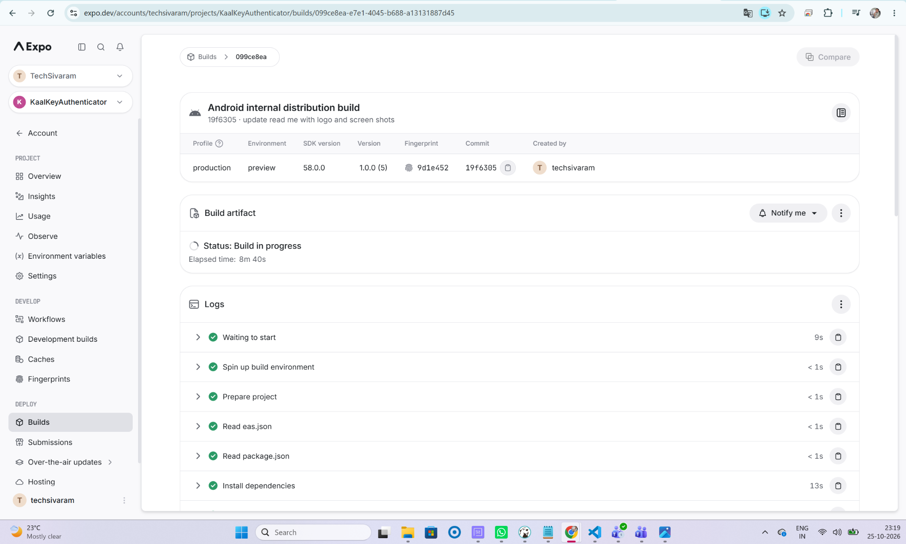
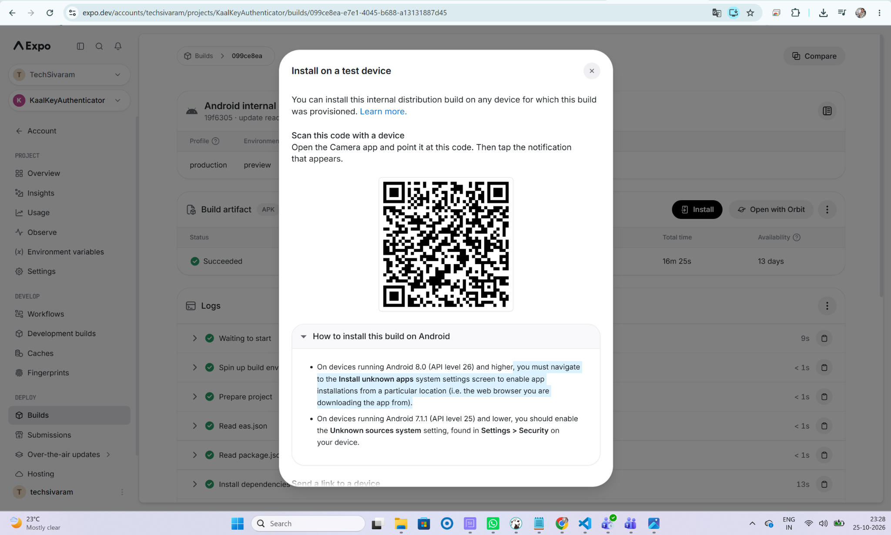

\<div *align*="center">


\


**# \<span style="color:#FF8A00">Kaal\</span>\<span style="color:#1673E6">K\</span>\<span style="color:#138A36">ey\</span> Authenticator**


**\*\*Your codes. Your device. Your control.\*\***


A cross-platform authenticator app for generating time-based one-time passwords (TOTP), with QR-based setup and account management for Android, iOS, and the web.

**Project links**

- **Marketing website:** https://kaalkey.onrender.com
- **Source code:** https://github.com/TechSivaram/kaalkey
- **LinkedIn:** https://lnkd.in/p/gGPpYt26


![Expo]\(https\://img.shields.io/badge/Expo-58-000020?logo=expo&logoColor=white)

![React Native]\(https\://img.shields.io/badge/React%20Native-0.88-61DAFB?logo=react&logoColor=black)

![React]\(https\://img.shields.io/badge/React-19-149ECA?logo=react&logoColor=white)

![TypeScript]\(https\://img.shields.io/badge/TypeScript-6-3178C6?logo=typescript&logoColor=white)

![Platforms]\(https\://img.shields.io/badge/Platforms-Android%20%7C%20iOS%20%7C%20Web-3A7D44)


**\*\*Brand palette:\*\*** \<span style="color:#FF8A00">Saffron \`#FF8A00\`\</span> · \<span style="color:#1673E6">Blue \`#1673E6\`\</span> · \<span style="color:#138A36">Green \`#138A36\`\</span>


\</div>


**---**


**## ✨ What is KaalKey?**


KaalKey Authenticator helps you manage time-based verification codes for services that support standard \`otpauth://\` TOTP enrollment. Add accounts by scanning a setup QR code, importing a QR image, pasting supported setup data, or entering details manually.


\> **\*\*Security note:\*\*** An authenticator secret is highly sensitive. Anyone who obtains it may be able to generate the same verification codes. Treat setup QR codes, secret keys, and exported backups like passwords.


**## 🚀 Features**


**### 🔐 One-time passwords**

\- Generate time-based one-time passwords (TOTP) from saved account secrets.

\- Support common TOTP algorithms: **\*\*SHA-1, SHA-256, and SHA-512\*\***.

\- Configurable code length and time period for supported entries.

\- Copy a generated code for use in the service you're signing in to.


**### 📷 Flexible account setup**

\- Scan an enrollment QR code with the device camera.

\- Import a QR code from an image where the platform and image format are supported.

\- Paste a QR image from the clipboard where browser/device clipboard APIs permit it.

\- Import supported \`otpauth://totp/...\` setup URLs.

\- Add an account manually when QR setup is not available.

\- Validate imported data and report invalid or duplicate entries.


**### 🗂️ Account management**

\- Store multiple authenticator accounts.

\- Keep service and account names organized.

\- View a QR code generated from an existing account's setup information. **\*\*That QR code contains the account secret—share it only if you intend to duplicate the authenticator.\*\***

\- Delete accounts when they are no longer needed.

\- For an existing account, edit **\*\*Service Name\*\*** and **\*\*Account Name\*\*** only. The secret key and OTP configuration are not intended to be editable through the account-edit form.


**### 💾 Backup and restore**

\- Export and restore account backups using the app's backup flow.

\- Keep backup files somewhere private and secure.

\- Use the password and import/export instructions shown by the app when creating or restoring a backup.


**### 📱 Cross-platform experience**

\- Built with Expo and React Native for Android, iOS, and web.

\- Platform-aware camera, file selection, clipboard, storage, and dialog behavior.

\- Activity feedback while longer operations are in progress.


**---**


**## 🖼️ Screenshots**


The screenshots below are the actual KaalKey UI images supplied with this README package. They use the app’s saffron-orange, blue, and green brand accents.


\| Home — empty vault | Add account | QR scanner |

\|---|---|---|

\| ![Home screen]\(docs/screenshots/home-empty-state.png) | ![Add account]\(docs/screenshots/add-account.png) | ![QR scanner]\(docs/screenshots/qr-scanner.png) |


\| Accounts and live OTP | Account QR security warning | Edit account |

\|---|---|---|

\| ![Account list with OTP]\(docs/screenshots/account-list-otp.png) | ![Account QR code warning]\(docs/screenshots/account-qr-code-warning.png) | ![Edit account]\(docs/screenshots/edit-account.png) |


\| App settings | Create encrypted backup | Restore backup |

\|---|---|---|

\| ![App settings]\(docs/screenshots/app-settings.png) | ![Create backup]\(docs/screenshots/create-backup.png) | ![Restore backup]\(docs/screenshots/restore-backup.png) |


\> **\*\*Screenshot safety:\*\*** The account-list and account-QR screenshots are illustrative UI examples. Never publish screenshots containing real OTP secrets, setup QR codes, or private account information.


**---**


**## 🧰 Technology stack**


\| Area | Technology | Purpose |

\|---|---|---|

\| App framework | [Expo]\(https\://expo.dev/) | App tooling, builds, and platform integrations |

\| UI framework | [React]\(https\://react.dev/) | Component-based interface |

\| Cross-platform UI | [React Native]\(https\://reactnative.dev/) | Shared mobile UI and native platform support |

\| Web rendering | [React Native Web]\(https\://necolas.github.io/react-native-web/) | Render the React Native interface in browsers |

\| Language | [TypeScript]\(https\://www\.typescriptlang.org/) | Static typing for application code |

\| Navigation | [Expo Router]\(https\://docs.expo.dev/router/introduction/) | File-based application routing |

\| OTP implementation | [\`otpauth\`]\(https\://github.com/hectorm/otpauth) | TOTP/OTP generation and URI parsing |

\| QR decoding | [\`jsQR\`]\(https\://github.com/cozmo/jsQR) | Decode QR data from supported image inputs |

\| QR rendering | [\`react-native-qrcode-svg\`]\(https\://github.com/awesomejerry/react-native-qrcode-svg) + [\`react-native-svg\`]\(https\://github.com/software-mansion/react-native-svg) | Render QR codes in the app |

\| Camera | [Expo Camera]\(https\://docs.expo.dev/versions/latest/sdk/camera/) | Camera-based QR scanning |

\| Image selection | [Expo Image Picker]\(https\://docs.expo.dev/versions/latest/sdk/imagepicker/) | Select QR images from the device |

\| Image processing | [Expo Image Manipulator]\(https\://docs.expo.dev/versions/latest/sdk/imagemanipulator/) | Prepare supported images for processing |

\| Clipboard | [Expo Clipboard]\(https\://docs.expo.dev/versions/latest/sdk/clipboard/) | Clipboard integration on supported platforms |

\| Native storage | [Expo SecureStore]\(https\://docs.expo.dev/versions/latest/sdk/securestore/) | Secure key-value storage on supported native platforms |

\| File operations | Expo FileSystem / DocumentPicker / Sharing | Work with backup files where supported |

\| Crypto utilities | [\`crypto-js\`]\(https\://github.com/brix/crypto-js), Expo Crypto | Cryptographic utilities used by app flows |

\| Device authentication | Expo Local Authentication | Platform biometric-authentication integration |

\| Code quality | ESLint, Prettier, TypeScript | Linting, formatting, and type checking |


*\*The table reflects dependencies configured in \`package.json\`; exact behavior can vary by operating system, browser, and runtime permissions.\**


**## 🧪 Sample test data**


Use the **\*\*dummy account below only for development and QA\*\***. Its secret is intentionally public and must never be used to protect a real account.


**### Sample TOTP account**


\| Field | Sample value |

\|---|---|

\| Service / issuer | \`KaalKey Demo\` |

\| Account name | \`demo\@example.com\` |

\| Secret (Base32) | \`JBSWY3DPEHPK3PXP\` |

\| Algorithm | \`SHA1\` |

\| Digits | \`6\` |

\| Period | \`30\` seconds |


**\*\*Sample \`otpauth://\` URI\*\*** — paste this into the app's supported TOTP URL import flow:


\`\`\`text

otpauth://totp/KaalKey%20Demo:demo%40example.com?secret=JBSWY3DPEHPK3PXP&issuer=KaalKey%20Demo&algorithm=SHA1&digits=6&period=30

\`\`\`


The generated code changes every 30 seconds, so there is no single permanent expected OTP for this sample. The important checks are that the URI imports successfully, the issuer and account labels are sensible, and a six-digit code refreshes on the expected time interval.


**### Manual-entry sample**


If testing manual setup, enter the same values from the table above into the corresponding fields. Use the Base32 secret exactly as shown, without spaces.


**### Suggested QA scenarios**


\| Test | Input / action | Expected result |

\|---|---|---|

\| Import a valid TOTP URI | Use the sample URI above | Account imports and displays a changing six-digit code |

\| Reject malformed URI | Try \`otpauth://invalid\` | A clear validation message appears; no account is added |

\| Reject invalid secret | Enter a non-Base32 secret such as \`NOT A SECRET!\` | Validation prevents importing/saving an unusable entry or reports an error |

\| Duplicate detection | Import the same sample account twice | Duplicate is detected and explained; no unintended duplicate is created |

\| QR camera flow | Scan a QR encoding the sample URI | The sample account is recognized and can be added |

\| QR image upload | Upload an image containing a QR encoding the sample URI | The sample account is recognized and can be added |

\| Clipboard image import | Paste a QR image encoding the sample URI where supported | QR data is decoded or a clear unsupported/invalid-image message appears |

\| Existing-account edit | Change only service and account names | Labels update; secret, algorithm, digits, and period remain unchanged |

\| Backup and restore | Back up the sample account, then restore it in a test profile | Restore follows the app's password and duplicate-handling flow |

\| Delete account | Delete the sample account | Confirmation is shown where supported and the account is removed |


**\*\*QR test fixture tip:\*\*** Generate a QR code from the sample URI using a trusted local QR utility or a test fixture in your development environment. Avoid pasting real authenticator URIs or secrets into online QR generators.


\> **\*\*Important:\*\*** This is manual QA guidance, not a claim that automated tests are included or have been run. Platform behavior can differ between browsers and devices; test camera, image upload, clipboard, and backup/restore on each target platform.


**---**


**## 🛡️ Storage, privacy, and limitations**


\- **\*\*No cloud sync is documented as part of this project.\*\*** Do not assume accounts automatically synchronize between devices.

\- **\*\*Native vs. web storage:\*\*** native storage uses Expo SecureStore where supported; the web build uses browser storage and does not provide the same protection guarantees as native secure storage.

\- **\*\*Browser security:\*\*** anyone with access to an unlocked browser profile or its local data may be able to access locally stored information. Use a trusted device and protect your operating-system/browser account.

\- **\*\*Camera and clipboard:\*\*** QR scanning and clipboard-image paste depend on permissions, secure-context rules, browser support, and device behavior. Clipboard image paste is not universally available.

\- **\*\*QR compatibility:\*\*** only QR images that can be decoded and contain a supported authenticator setup payload can be imported. Unsupported formats or damaged images may fail.

\- **\*\*Backup responsibility:\*\*** keep backup files and their passwords safe. If a backup password is lost and there is no recovery mechanism, the backup may be unrecoverable.

\- **\*\*Secret visibility:\*\*** a setup QR code or exported secret can clone an authenticator entry. Never post it publicly or send it to an untrusted person.

\- **\*\*Authenticator scope:\*\*** this app generates TOTP codes; it does not approve sign-ins on behalf of a service or recover a service account if you lose access to its second-factor setup.


**## ⚙️ Requirements**


\- Node.js and npm compatible with the installed Expo SDK.

\- A local copy of this repository.

\- For device testing: Android Studio/device tooling for Android, Xcode on macOS for native iOS builds, or a compatible browser for web testing.


**## 🏁 Get started**


**### 1. Install dependencies**


\`\`\`bash

npm install

\`\`\`


**### 2. Start the development server**


\`\`\`bash

npm start

\`\`\`


Use the Expo CLI prompts to open the app on a connected/simulated device, or start a platform-specific target below.


**### 🌐 Run the web development build**


\`\`\`bash

npm run web

\`\`\`


**### 📦 Export a static web build**


\`\`\`bash

npx expo export --platform web

\`\`\`


Expo writes the static output to \`dist/\`. To preview that exported build locally, serve the folder over HTTP rather than opening \`index.html\` directly. For example, with Python installed:


\`\`\`bash

python -m http.server 8080 --directory dist

\`\`\`


Then open \`http\://localhost:8080\` in your browser.


**### 🤖 Android**


\`\`\`bash

npm run android

\`\`\`


This runs the Expo native Android workflow and may require Android Studio/SDK setup.


**### 🤖 Android production build**

For the production Android build, run:

\`\`\`bash
npx eas-cli build --platform android --profile production
\`\`\`

**### 🍎 iOS**


\`\`\`bash

npm run ios

\`\`\`


Native iOS builds require macOS and Xcode.


**## 🚀 Why Expo and EAS Build?**

KaalKey uses Expo and React Native to share much of its application code across Android, iOS, and web while still supporting platform-specific capabilities where needed.

**### Benefits of Expo**

- **Cross-platform development:** Build a shared app experience for Android, iOS, and web from one codebase where practical.
- **Faster development workflow:** Expo provides commands and tooling for starting the app, running platform targets, and testing changes.
- **Native API integrations:** Expo SDK modules provide access to device capabilities such as camera, image picking, secure storage, clipboard, and local authentication, subject to platform support and permissions.
- **Simplified project setup:** Expo manages much of the app configuration and development workflow, reducing the amount of native setup needed for common use cases.
- **Build and release options:** Expo tooling can be used with EAS services to create installable builds and support release workflows.

**### Expo CLI vs. EAS CLI**

These tools serve different purposes:

| Tool | Main purpose | Example |
|---|---|---|
| Expo CLI (`npx expo`) | Run the development server, launch platform targets, and export the web app | `npx expo start` |
| EAS CLI (`npx eas-cli`) | Configure and run Expo Application Services workflows, including cloud builds | `npx eas-cli build --platform android --profile production` |

**### Production Android build with EAS**

KaalKey uses EAS Build for its production Android build. Run this command from the project directory:

```bash
npx eas-cli build --platform android --profile production
```

This asks EAS Build to create an Android artifact using the `production` profile defined in the project's EAS configuration. The build runs remotely on Expo's build infrastructure when configured for EAS cloud builds, so a local Android Studio installation is not necessarily required for that cloud build. You may need to sign in to your Expo account and configure Android credentials or build settings.

In the Expo dashboard, open the KaalKeyAuthenticator project and select **Builds** to inspect build status, logs, profile, SDK version, app version, and available artifacts. A build marked **In progress** has not finished yet; wait for a successful status before downloading or distributing the artifact.

**Note:** The `production` profile name alone does not determine whether a build is publicly released. Distribution and store submission depend on the profile configuration and the release steps you perform.

---

## 📦 Android production build (Expo EAS)

- **Expo EAS build details:** https://expo.dev/accounts/techsivaram/projects/KaalKeyAuthenticator/builds/099ce8ea-e7e1-4045-b688-a13131887d45

The production Android build is managed through Expo Application Services (EAS). The screenshot below shows the KaalKeyAuthenticator build page in the Expo dashboard.



To start a production Android build, run:

```bash
npx eas-cli build --platform android --profile production
```


### Install the Android build on a test device

After the EAS build succeeds, the Expo dashboard provides an install option for the internal distribution APK. You can use the QR code shown in the dashboard to open the installation flow on a test device.



On Android, follow the instructions displayed by Expo. Depending on the Android version and device policy, you may need to allow installation of unknown apps for the browser or app used to download the APK. Only install builds from a source you trust.


**## 🧪 Quality checks**


\`\`\`bash

npm run lint

npx tsc --noEmit

npm run format:check

\`\`\`


Run these checks after making changes. A successful static export does not by itself guarantee that every device/browser feature works; test QR scanning, image import, clipboard behavior, and backup/restore on the platforms you intend to support.


**## 📁 Project map**


\`\`\`text

.

├── assets/             # App icons, splash assets, and brand images

├── src/

│   ├── app/            # App screens and routing

│   ├── hooks/          # Reusable React hooks

│   ├── styles/         # UI styles

│   ├── constants/      # Shared constants

│   └── types/          # TypeScript declarations and types

├── app.json            # Expo app configuration

├── package.json        # Scripts and dependencies

└── README.md

\`\`\`


**## 🧭 Important editing rule**


When changing KaalKey, preserve the existing platform-specific behavior. In particular, account editing is intentionally limited to service and account names; QR scanning, QR image import, TOTP URL import, backup/restore, and storage behavior should be regression-tested after changes.


**## 📄 License**


See [\`LICENSE\`]\(LICENSE) for the license information included with this source bundle.


**---**


\<div *align*="center">

  \<sub>Built for practical, device-based two-factor authentication. Keep your secrets private. 🔑\</sub>

\</div>
